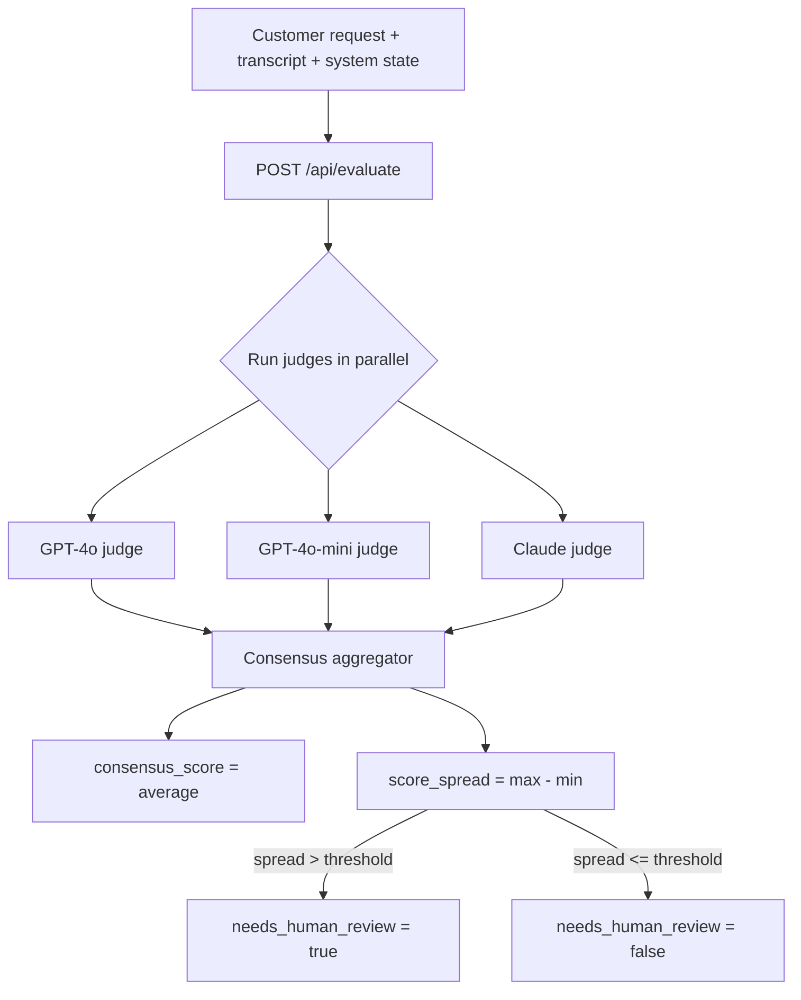

# Multi-Judge Consensus

A small full-stack app that evaluates whether an AI customer-support agent actually
completed a task correctly — by asking **multiple LLMs to independently judge the
same interaction in parallel**, then flagging the result for human review whenever
the judges disagree too much.

This is a common technique in LLM evaluation pipelines ("LLM-as-a-judge"): a single
judge model can be biased, inconsistent, or simply wrong. Running several
heterogeneous judges and treating *disagreement* as a signal of ambiguity gives you
a cheap, automatic way to route uncertain cases to a human instead of silently
trusting one model's score.

**Live/demo friendly by design:** the app runs fully end-to-end with zero API keys.
Every judge falls back to a deterministic, explainable mock scorer when its provider
isn't configured, so anyone can clone this repo and try it immediately. Add real
`OPENAI_API_KEY` / `AZURE_OPENAI_*` / `ANTHROPIC_API_KEY` values to switch any judge
over to live model calls — no code changes required.

---

## How it works



Each judge is asked the same question — *"on a 0-10 scale, how completely was this
request resolved?"* — and returns a score plus a short justification. The
consensus layer averages the scores and uses the **spread** between the highest and
lowest score as a proxy for how confident the group verdict is.

## Features

- **Parallel evaluation** — judges run concurrently via `asyncio.gather`, not sequentially.
- **Resilient to provider failures** — if one judge's API call throws (timeout, rate
  limit, bad response), it's excluded from the consensus instead of crashing the
  whole request; if *every* judge fails, the pipeline still returns a clearly
  flagged, zero-confidence result.
- **Demo mode with zero setup** — no API keys needed to run, test, or demo the app.
  Mock scores are deterministic (seeded from the input text) and reflect real
  signal (keyword overlap between the request and the transcript/system state).
- **REST API + browser UI** — a FastAPI backend with interactive OpenAPI docs at
  `/docs`, and a small static web UI to try it without writing any code.
- **Configurable review threshold** — tune how much disagreement triggers a human
  review flag via `REVIEW_THRESHOLD`.
- **Tested** — unit tests for the consensus/aggregation logic (including failure
  modes) and integration tests for the HTTP API.

## Project structure

```
multi-judge-consensus/
├── app/
│   ├── main.py        # FastAPI app: routes + static file serving
│   ├── consensus.py   # Parallel judge orchestration + aggregation
│   ├── judges.py       # Judge implementations (live LLM calls + demo fallback)
│   ├── models.py       # Pydantic request/response schemas
│   └── config.py       # Environment-driven settings
├── static/              # Vanilla HTML/CSS/JS browser UI
├── tests/               # pytest unit + API tests
├── .github/workflows/   # CI: runs the test suite on every push/PR
├── Dockerfile
├── requirements.txt
└── .env.example
```

## Running locally

```bash
python -m venv .venv
.venv\Scripts\activate          # Windows
# source .venv/bin/activate     # macOS/Linux

pip install -r requirements.txt
uvicorn app.main:app --reload
```

Open <http://127.0.0.1:8000> for the UI, or <http://127.0.0.1:8000/docs> for the
interactive API docs. Click **"Load example"** to try it immediately — no
configuration required.

### Enabling real LLM judges

Copy `.env.example` to `.env` and fill in whichever providers you have access to:

```bash
copy .env.example .env   # Windows
# cp .env.example .env   # macOS/Linux
```

Any provider left blank keeps that judge in demo mode — you can mix, e.g. run
GPT-4o and GPT-4o-mini live while Claude stays mocked.

## Running with Docker

```bash
docker build -t multi-judge-consensus .
docker run -p 8000:8000 --env-file .env multi-judge-consensus
```

## Running tests

```bash
pip install -r requirements-dev.txt
pytest -v
```

CI runs the same suite automatically on every push via GitHub Actions
(`.github/workflows/ci.yml`).

## Example API usage

```bash
curl -X POST http://127.0.0.1:8000/api/evaluate \
  -H "Content-Type: application/json" \
  -d '{
    "customer_request": "Return damaged chocolate box and get refund",
    "transcript": "Agent authorized a return and refunded $45.99 as requested.",
    "system_state": "Return authorized, refund $45.99 initiated"
  }'
```

```json
{
  "consensus_score": 8.2,
  "individual_results": [
    {"judge_name": "gpt-4o", "mode": "demo", "score": 8.7, "reasoning": "..."},
    {"judge_name": "gpt-4o-mini", "mode": "demo", "score": 7.6, "reasoning": "..."},
    {"judge_name": "claude", "mode": "demo", "score": 8.3, "reasoning": "..."}
  ],
  "score_spread": 1.1,
  "needs_human_review": false,
  "review_threshold": 3.0
}
```

## Why this project

This project was built to demonstrate practical skills relevant to LLM application
engineering:

- Designing an **LLM-as-a-judge evaluation pipeline** and reasoning about its
  failure modes (single-model bias, provider outages, ambiguous cases).
- **Async Python** — concurrent I/O-bound calls, graceful per-task error handling.
- **API design** — a clean FastAPI service with typed request/response models,
  input validation, and auto-generated docs.
- **Testability** — designing business logic (`consensus.py`) so it can be fully
  unit-tested via dependency injection/monkeypatching, independent of any live
  model provider.
- **Developer experience** — a project that a reviewer (or recruiter) can clone and
  run in under a minute with zero configuration.

## License

MIT — see [LICENSE](LICENSE).
